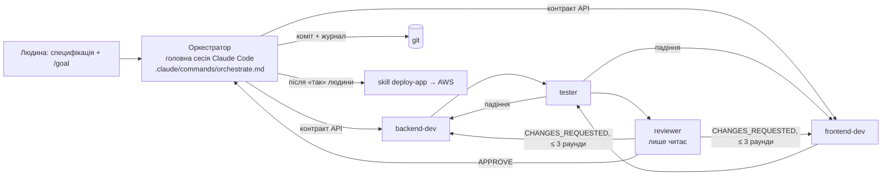

# AI-first розробка: як зроблено цей проєкт

Увесь код фіч написали AI-агенти Claude Code. Людина ставила цілі, затверджувала контракт, деплой і merge. Конфігурація агентів лежить у репозиторії, тож процес можна відтворити.

## Схема



## Що в репозиторії

| Файл | Навіщо |
|---|---|
| `CLAUDE.md`, `frontend/…/CLAUDE.md`, `aqa/…/CLAUDE.md` | правила проєкту для будь-якого агента |
| `.claude/commands/orchestrate.md` | процес оркестратора: контракт → розробка → тести → рев'ю → коміт → журнал |
| `.claude/agents/backend-dev.md` | .NET-розробник; межі — лише `backend/` |
| `.claude/agents/frontend-dev.md` | Angular-розробник; межі — лише `frontend/` |
| `.claude/agents/tester.md` | шукає невідповідності специфікації, дописує граничні тести; продакшн-код не чіпає |
| `.claude/agents/reviewer.md` | лише читає; чекліст: специфікація, авторизація, сумісність контракту, простота, секрети |
| `.claude/skills/add-api-endpoint/` | повторювана процедура «новий ендпоінт = хендлер + маршрут + API Gateway + тест + документація» |
| `.claude/skills/deploy-app/` | деплой і перевірка через `scripts/` з людським підтвердженням для інфраструктури |
| `.claude/settings.json` | дозволені команди (build/test) і заборонені (`destroy`, `terraform destroy`, читання `.env`) |
| `docs/features/*.md` | для кожної фічі: сценарій, рішення, що відкинули, як перевірити, обмеження |

## Goal-loop
Кожну фічу запускає `/goal` з умовою, яку можна перевірити. Окрема модель-оцінювач після кожного ходу читає транскрипт і вирішує, чи умова виконана. Тому в умові завжди є команда з exit-кодом і обмеження на кількість ходів.

Приклад (базова фіча групового pre-order):
```
/goal Реалізовано специфікації ~/EPAM/marathon/agent-tasks/A2-backend.md і A3-frontend.md за процесом .claude/commands/orchestrate.md. Доказ у транскрипті: `dotnet test` у backend/restaurant-backend-app — exit 0; `npm run test:hw` у frontend/restaurant-frontend-app — exit 0 з тестами practice, level-1, level-2, level-3, level-3-bonus у src/app; останнє рев'ю — VERDICT: APPROVE; `git status` чистий. Або зупинись після 60 ходів.
```

## Людські чекпоінти
- затвердити контракт API, якщо специфікація неоднозначна;
- `terraform apply`: агент показує план, людина каже «так»;
- merge у `main` і деплой;
- будь-яке видалення в AWS (заборонено в `settings.json`).

## Журнал

| Дата | Фіча | Агенти | Раундів рев'ю | Що знайшли tester / reviewer | Коміт |
|---|---|---|---|---|---|
| 2026-11-05 | Груповий pre-order Owner (A2 backend L1–L3 + A3 frontend practice–L3 + Remove Guest, верстка за Figma) | backend-dev ∥ frontend-dev → tester ×3 → reviewer ×3 | 3 (CHANGES_REQUESTED → CHANGES_REQUESTED → APPROVE) | tester: екран Owner ламався для повної/submitted групи (invite-endpoints давали 400), snapshot після DELETE показував видаленого гостя (GSI eventually consistent); reviewer: гонка двох submit подвоювала страви в order → claim групи з `[DynamoDBVersion]` + компенсація | ef493ef, 2605a77, 8c44a4e |
